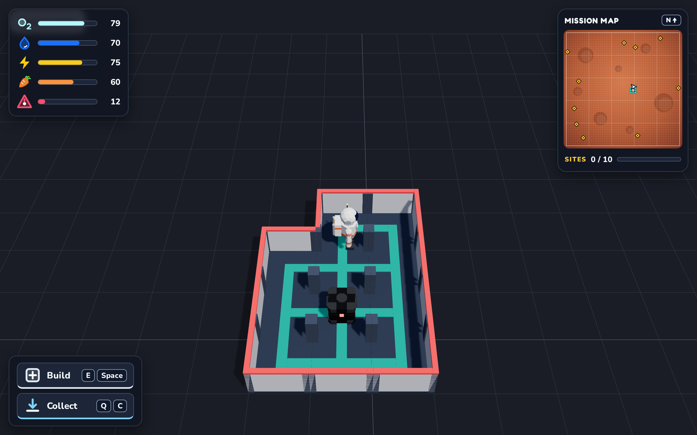
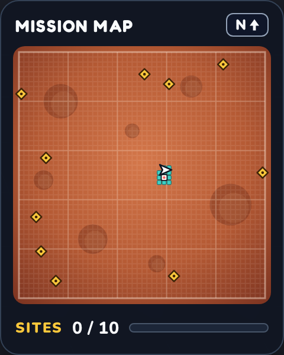
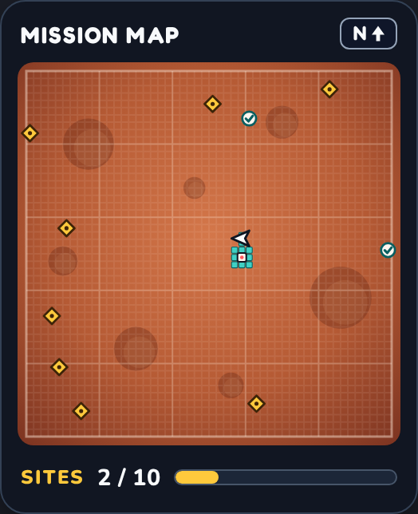
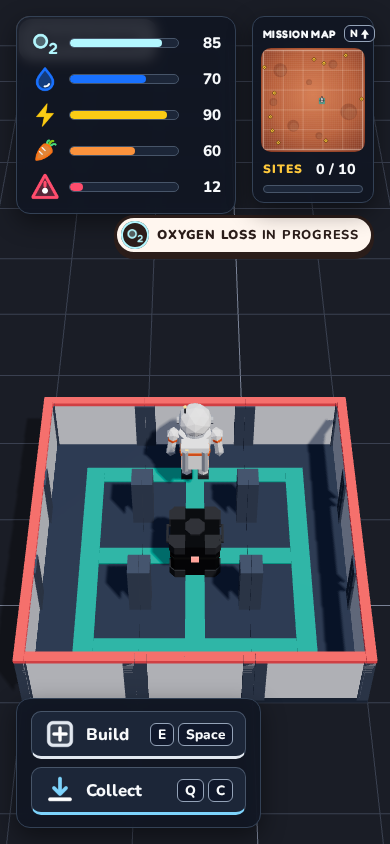

# Mission Minimap (`MissionMinimap.tsx`)

## 1. Overview

A north-up map of the whole 50×50 world in the top-right corner of the mission HUD. It shows the constructed base (with the Stash), the investigation sites and how many are completed, and the player's position and facing. It updates live while the player moves and builds.

### Scope
- **Included:** world grid, live base occupancy, Stash badge, pending/completed investigation sites, `SITES completed / total` progress, player marker.
- **Excluded:** fog of war, pathfinding, zoom or a full-screen map, multiplayer players, terrain data, mission logic. The minimap only *visualizes* existing state; it never changes game state.

### Appearance
- Frame built from the shared HUD panel tokens (`--hud-panel-*`, `--hud-text` in `theme.css`), like `ResourceBar`, `ActionButtons` and the hazard label. The `MISSION MAP` title uses the same type as the other HUD labels (Nunito 900, uppercase, `0.06em`), and the progress track the same 10 px track as the ResourceBar. The map is always north-up; there is no north badge.
- Warm Martian ground (radial gradient + a few decorative craters). **The background is stylized**: it is not HiRISE or any measured topography, and it does not match the 3D scene.
- Subtle 1-cell grid lines, stronger lines every 10 cells, and a light world border.
- Base cells: teal squares. Stash: cream square with a coral light, drawn on top of its cell.
- Pending site: golden diamond with a dark core. Completed site: cream disc with a teal checkmark. Shapes differ, so the state never depends on color alone.
- Player: white arrow with a dark outline, pointing in the facing direction.

### Screenshots

| Mission HUD (1280×800) | Live map after building two corridors |
|---|---|
|  |  |

| Completed sites (test fixture render) | Phone (390×844) with hazard label |
|---|---|
|  |  |

The completed-sites image is an isolated render of `MissionMinimap` with two extra tiles covering mock sites (49, 24) and (30, 6). Those cells are outside the sandbox build area (see Known Limitations), so this state cannot be reached in play yet.

## 2. Architecture

```text
src/
├── PlayerSandboxView.tsx          # Owns the minimap's React state, wires the sandbox callbacks
├── game/
│   ├── PlayerSandbox.ts           # Publishes construction + player snapshots (world cells)
│   ├── corridor/CorridorGrid.ts   # Source of truth for construction occupancy
│   └── minimap/
│       ├── missionMap.ts          # Types, coordinate helpers, objective progress (pure)
│       └── PlayerSnapshotStore.ts # Latest player snapshot, read by the marker via useSyncExternalStore
└── ui/
    ├── MissionMinimap.tsx         # SVG presentation component
    └── missionMinimap.css
```

| Module | Responsibility |
|---|---|
| `CorridorGrid` | Owns occupancy. Exposes `getOccupiedTiles()` (copied snapshot, local coordinates) and `onOccupancyChange(listener)` (fires only when tiles are actually added or removed). |
| `PlayerSandbox` | Applies authoritative constructions and player positions to the scene. Publishes the local player marker through `PlayerSandboxListeners`; mock occupancy is only used as a fallback before match state arrives. |
| `PlayerSandboxView` | Uses fallback constructions only before server state arrives and owns a `PlayerSnapshotStore` (`playerStore.set` is the player callback). Passes the server grid, constructions, and investigation sites to `MissionMinimap` and disposes the sandbox on unmount. Also renders the top-right HUD column, where an optional `topRightStatus` sits under the minimap. |
| `MissionMinimap` | Pure presentation: renders the props as SVG. |
| `missionMap.ts` | Shared types and pure helpers, unit tested. |
| `PlayerSnapshotStore` | Keeps the latest player snapshot outside React state. Exposes `getSnapshot` / `subscribe` (`MissionMapPlayerSource`) for `useSyncExternalStore` and `set` for the sandbox; skips notifying when the same snapshot is set again. |

No global store, event bus or second Three.js scene is involved.

## 3. Coordinate Conventions

Server/world cells: `cellX` grows west → east, `cellY` grows north → south, `(0, 0)` is the north-west cell, `(49, 49)` the south-east cell.

The scene is relative to the authoritative stash cell (initially the mock `INITIAL_BASE_ORIGIN = { cellX: 29, cellY: 25 }`), with tile centres on integer `(x, z)` and `-Z` = north:

```ts
sandboxToWorldCell(localX, localZ, stashOrigin)
// → { cellX: localX + stashOrigin.cellX, cellY: localZ + stashOrigin.cellY }
```

The result keeps the scene convention (integer = tile centre) and stays continuous for the player, so the marker moves smoothly instead of jumping between cells.

The minimap SVG uses **one user unit per cell** (`viewBox` covers `[0, 50]` plus a 1.2-cell margin so edge markers are not clipped). Cell `(x, y)` covers `[x, x + 1) × [y, y + 1)`, so markers are drawn at its centre:

```ts
worldCellToMinimapPoint({ cellX: 29, cellY: 24 }) // → { x: 29.5, y: 24.5 }
```

This matches the server spawn format (slot 0 is `{ x: 29.5, y: 24.5 }`). Base cells are drawn as squares from the cell corner (`cellX + inset`).

`facingToMinimapRotation` turns the player facing into a clockwise angle: `up` 0°, `right` 90°, `down` 180°, `left` 270°.

## 4. Data Sources and Updates

| Data | Source | When it updates |
|---|---|---|
| Grid size | `match.state.grid` (mock payload before state arrives) | Match state |
| Investigation sites | `match.state.investigation` (mock payload before state arrives) | Match state; 3D sites are replaced when the server site list or stash origin changes |
| Constructions | `match.state.constructions` | Match state/frames; server-authoritative |
| Player | Authoritative player position applied by `PlayerSandbox`, then `onPlayerChange` → `PlayerSnapshotStore` | Initial server position, then sampled about every 0.1 s while position or facing changes |

Construction state is never derived from meshes or button clicks. The live minimap uses the server snapshot, so rejected build requests do not change it.

### Rendering cost
- When the player stands still, the sandbox sends nothing and React does not re-render.
- Player updates go into `PlayerSnapshotStore`, not React state. Only `MinimapPlayer` subscribes (`useSyncExternalStore`), so ~10 Hz updates re-render just the marker; `PlayerSandboxView`, `ResourceBar`, `ActionButtons` and the rest of `MissionMinimap` stay untouched (verified in the browser by counting renders while walking).
- Terrain, base and sites are `memo` sub-components, so they only re-render when their snapshot data changes. Grid lines are two `<path>` elements.
- The marker eases between updates with a 120 ms CSS `transform` transition (disabled with `prefers-reduced-motion`). Rotation snaps to the new facing to avoid spinning the long way round.

## 5. Objective Completion

Mirrors the server rule: a site is completed when a construction occupies its cell.

```ts
resolveInvestigationProgress(investigation, constructions, grid)
// → { sites: [{ cellX, cellY, completed }], completed, total }
```

Any construction kind counts (`base_tile` or `stash`). Sites outside the grid are ignored for both drawing and counting. The footer shows `SITES completed / total` with a golden progress bar.

## 6. Layout

- Top-right, 16 px from the edges, in `.player-sandbox__top-right` (a column that also stacks the hazard "in progress" label under the map).
- The column owns the width (`--top-right-hud-width` in `player.css`) and stretches both children to it, so **the minimap is always exactly as wide as the hazard "in progress" label**.
- Above 900 px the width is a fixed 272 px: the longest label ("SOLAR STORM in progress") measured with the Nunito 800/900 metrics, so every label fits on one line. The top-centre hazard banner narrows instead (`min(560px, 100% − 2 × 304px)`), so it always fits between the ResourceBar and the minimap.
- At 900 px and below (the banner moves to the bottom), `clamp(120px, 100vw − 268px, 272px)` keeps it beside the 220 px `ResourceBar`; the width is continuous across 900/901 px. On narrow widths the label text wraps.
- Below 388 px there is no room beside the ResourceBar, so the column moves under it (`top: 190px`, for the four-row ResourceBar) and the map keeps its 120 px minimum. Below 480 px the frame chrome gets more compact.
- The layout was previously verified at 320×568, 320×640, 360, 390, 900, 901, 1000 and 1280 px wide; verify again after any HUD sizing changes.
- `pointer-events: none`: the map never blocks the scene or input.

## 7. API, Configuration and Security

`PlayerSandboxView` consumes the server's match state and frame snapshots; the mock payload is only a fallback before state is available. The minimap performs no network requests itself.

## 8. Edge Cases

| Scenario | Behavior |
|---|---|
| No player source, or no snapshot yet | Player marker is not drawn. |
| No constructions / no sites | Empty map; progress shows `0 / 0` with an empty bar. |
| Construction or site outside the grid | Not drawn (sites are not counted). |
| Player outside the grid | Marker is clamped to the map edge. |
| Scene unmount | `PlayerSandbox.dispose()` stops the frame loop (no more player updates) and `CorridorGrid.dispose()` clears occupancy listeners. |

## 9. Testing

`tests/minimap/`:
- `missionMap.test.ts`: sandbox → world and world → minimap conversion, spawn alignment, clamping, grid boundaries, facing rotation, objective completion and counts, empty and out-of-grid data.
- `corridorGridOccupancy.test.ts`: initial 3×3 base and Stash, snapshot copies, notifications for placement, duplicates, removal, protected Stash, unsubscribe and dispose.
- `minimapConstructionSync.test.tsx`: integration of a real `CorridorGrid` wired like `PlayerSandbox` → published world constructions → objective progress → rendered minimap. Covers the initial base, completing a mock-payload objective by placing a tile on its cell, adjacent tiles not completing it, duplicates publishing nothing, removal reverting the objective, and no publishing after dispose. The mock objectives are not modified.
- `MissionMinimap.test.tsx`: static render of base cells, Stash position, construction add/remove, pending/completed sites, progress and its ARIA range (0–100 with a text value, valid even with 0 sites), the map label counting only drawn cells, player position/rotation/clamping, a missing player source and empty data.
- `playerSnapshotStore.test.ts`: latest snapshot, notifications (none for a repeated snapshot), unsubscribe, bound methods.

```bash
bun test ./tests
bun run typecheck:tests
bun x tsc --noEmit
bun run build
```

`PlayerSandbox` itself needs WebGL and is not unit tested; its throttling was verified in the browser.

## 10. Known Limitations

- Only the local player is shown on the minimap; investigation sites, constructions, and grid size come from authoritative match state when available.
- The background is decorative and does not represent real terrain.
- On narrow phones the stacked layout assumes the four-row ResourceBar and a viewport at least ~568 px tall; on shorter screens the minimap can touch the action buttons.

## 11. Live Match Integration

`PlayerSandboxView` passes `match.grid`, `match.investigation`, and `match.constructions` to `MissionMinimap`. `PlayerSandbox` applies authoritative player coordinates and publishes the local marker through `PlayerSnapshotStore`; protocol coordinates such as `29.5` convert to the map's tile-center convention by subtracting `0.5`. `MissionMinimap` remains presentational.

## 12. Change History

| Date | Version | Description |
|---|---|---|
| 2026-11-15 | 1.0.0 | Initial implementation |
| 2026-11-15 | 1.1.0 | Frame uses the HUD panel tokens; width shared with the hazard "in progress" label (272 px) |
